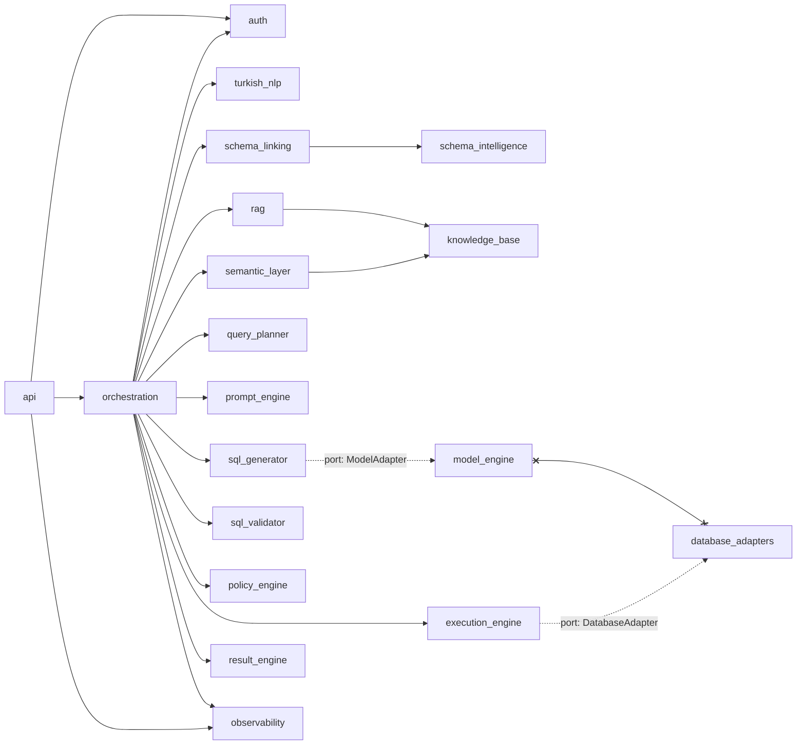

# Modül Haritası ve Bağımlılık Kuralları

Kaynak: `backend/boundaries.toml` (CI'da `tools/check_boundaries.py` ile denetlenir).

## Repository yapısı

```
SorguMuhendisim_TRSQL/
├── backend/                  # Modular monolith (Python)
│   ├── api/                  # L1  FastAPI uç noktaları
│   ├── core/                 # —   Sözleşmeler, portlar, hatalar, ayarlar (paylaşılan çekirdek)
│   ├── auth/                 # L1  Kimlik doğrulama, RBAC, şema kapsamlama
│   ├── orchestration/        # —   Yaşam döngüsü, yeniden deneme bütçesi, bağlama (wiring)
│   ├── turkish_nlp/          # L2  Türkçe çözümleme
│   ├── schema_intelligence/  # L3  Schema Graph, JOIN yolu
│   ├── schema_linking/       # L3  Kelime → tablo/sütun eşleştirme
│   ├── knowledge_base/       # L4  Kurumsal kurallar, metrikler, örnekler
│   ├── rag/                  # L4  Bilgi getirme, dinamik few-shot
│   ├── semantic_layer/       # L4  Onaylı metrik tanımları
│   ├── query_planner/        # L5  Sorgu planı
│   ├── prompt_engine/        # L5  Sürümlü istem şablonları
│   ├── model_engine/         # L5  ModelAdapter uygulamaları (yerel LLM)
│   ├── sql_generator/        # L5  Model çıktısından SQL adayı
│   ├── sql_validator/        # L6  8 aşamalı doğrulama
│   ├── policy_engine/        # L6  ApprovedQuery üretimi (LIMIT, timeout)
│   ├── execution_engine/     # L7  Tek veritabanı kapısı
│   ├── database_adapters/    # L7  SQLite / PostgreSQL sürücüleri
│   ├── result_engine/        # L8  Tablo, grafik, Türkçe açıklama
│   └── observability/        # L9  Audit, maskeleme, metrikler
├── frontend/                 # L0  React + TypeScript (AR-10)
├── models/                   # Model kartları ve indirme betikleri (ağırlıklar git'e girmez)
├── datasets/                 # Veri kümesi kartları ve lisanslar (ham veri git'e girmez)
├── benchmarks/               # Değerlendirme koşucuları ve metrik tanımları
├── experiments/              # D0–D8 deney konfigürasyonları ve sonuç özetleri
├── synthetic_data/           # Sentetik kurumsal veri üretimi (AR-06)
├── security_policies/        # Rol / tablo / sütun politikaları (örnekler)
├── tests/                    # unit · security · integration · architecture
├── configs/                  # Çalışma zamanı ayarları (gizli bilgi içermez)
├── research/                 # Literatür notları, AR paketi raporları
├── docs/                     # Mimari, ADR, güvenlik, değerlendirme, rehberler
├── deployment/               # On-prem dağıtım (AR-10)
└── tools/                    # Geliştirici araçları (sınır denetleyici vb.)
```

## İzin verilen iç bağımlılıklar

`core` her modül için her zaman serbesttir ve kendisi hiçbir modülü içe aktaramaz.

| Modül | İçe aktarabileceği modüller |
|---|---|
| `api` | `auth`, `orchestration`, `observability` |
| `orchestration` | tüm iş modülleri (tek birleştirici) |
| `schema_linking` | `schema_intelligence` |
| `rag`, `semantic_layer` | `knowledge_base` |
| diğer tüm modüller | yalnız `core` |



## Dış paket kısıtları

| Paket | Yalnızca |
|---|---|
| `sqlite3`, `psycopg`, `asyncpg`, `sqlalchemy` | `database_adapters` |
| `fastapi`, `starlette`, `uvicorn` | `api` |
| `llama_cpp`, `onnxruntime`, `torch`, `transformers` | `model_engine` |
| `sqlglot` | `sql_validator`, `policy_engine` |
| `requests`, `httpx`, `urllib3` | hiçbiri (offline-first) |

## Genel API kuralı

Modüller arası içe aktarma, modülün `__init__.py` üzerinden açtığı **genel API**'yi
hedeflemelidir:

```python
from backend.rag import KeywordRetriever  # ✅
from backend.rag.retriever import KeywordRetriever  # ❌ (başka modülden)
```

Bir modülü bağımsız servise ayırmak istendiğinde değişecek tek yer genel API'dir.
