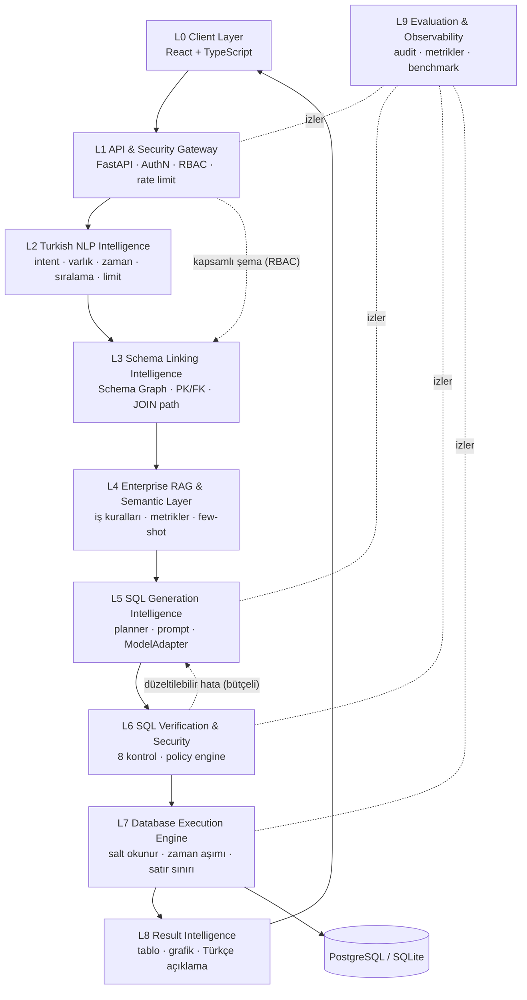

# TRSQL Mimari Genel Bakış — v0.2 (Research Candidate)

> **Durum:** Araştırma adayı. AR-01–AR-08 araştırmaları ve prototip deneyleri
> tamamlandıktan sonra AR-09'da kesinleşir. Kesinleşmemiş her karar bu
> dokümanda "aday" olarak işaretlidir.

## 1. Vizyon

TRSQL yalnızca Türkçe metni SQL'e çeviren bir uygulama değildir. **Türkçe doğal dil
ile kurumsal veritabanları arasında güvenli, açıklanabilir ve yerel çalışan bir veri
erişim platformudur.**

Hedef sistem:

- Türkçeyi anlar (morfoloji, ekler, göreli zaman ifadeleri),
- küçük modellerle (3B–9B, 4-bit) düşük donanımda çalışır,
- kurumsal iş kurallarına hâkimdir,
- güvenliği tasarımın başında ele alır.

Bu mimaride **yapay zekâ modeli sistemin tamamı değil, sistemin içindeki değiştirilebilir
bir bileşendir.** Modelin yapamayacağı ya da yapmaması gereken her şey (yetkilendirme,
iş kuralı tanımı, sayısal hesaplama, veritabanı erişimi) deterministik katmanlara aittir.

### Sürümler

| Sürüm | Ad | Açıklama |
|---|---|---|
| v0.1 | Başlangıç mimarisi | Üç diyagramdaki klasik LLM tabanlı Text-to-SQL akışı (Gateway → Schema Analyzer → LLM → Validator → DB). |
| **v0.2** | **Research Candidate** | Bu doküman. Bağımsız katmanlara ayrılmış L0–L9 yapısı. |
| v1.0 | Nihai mimari | AR-09 sonunda deney sonuçlarına göre kesinleşir. |

### Referans donanım

| Bileşen | Değer |
|---|---|
| GPU | RTX 4070 Laptop, 8 GB VRAM (net bütçe ≈ 6,8 GB) |
| RAM | 32 GB |
| İşletim sistemi | Windows (geliştirme), Linux (dağıtım adayı) |

Bütün model ve çalışma zamanı kararları bu donanımda ölçülür (bkz. [değerlendirme planı](../evaluation/evaluation-plan.md)).

## 2. v0.1 bileşenlerinin değerlendirilmesi

| Bileşen | Karar | Açıklama | v0.2 karşılığı |
|---|---|---|---|
| FastAPI Gateway | Korunmalı | Sistemin API giriş noktası. | L1 `api` |
| Schema Analyzer | Genişletilmeli | Tabloların yanında ilişkileri, veri türlerini ve anlamlarını bilmeli. | `schema_intelligence` + L3 `schema_linking` |
| LLM SQL Generator | Yeniden düzenlenmeli | Model, istem hazırlama ve RAG birbirinden ayrılmalı. | L5 `query_planner`, `prompt_engine`, `model_engine`, `sql_generator` |
| Prompt Engineering | Korunmalı | Dinamik istem oluşturma motoruna dönüştürülmeli. | L5 `prompt_engine` |
| Few-Shot | Korunmalı | Soruya uygun örnekleri otomatik seçmeli. | L4 `rag` (dinamik örnek seçimi) |
| RAG | Genişletilmeli | Bağımsız kurumsal bilgi katmanı olmalı. | L4 `knowledge_base`, `rag`, `semantic_layer` |
| SQL Validator | Genişletilmeli | Sözdizimi, anlam, şema, yetki ve maliyet denetimi yapmalı. | L6 `sql_validator` + `policy_engine` |
| Error Feedback Loop | Sınırlandırılmalı | Sonsuz döngüye veya güvenlik ihlaline izin vermemeli. | `orchestration` (ADR-0005, ADR-0006) |
| PostgreSQL / SQLite | Korunmalı | Veritabanı adaptörleri üzerinden kullanılmalı. | `database_adapters` |
| Auth & RBAC | Yeniden konumlandırılmalı | Şema bilgisi alınmadan önce yetkilendirme yapılmalı. | L1 `auth` (ADR-0004) |
| Audit Logs | Genişletilmeli | Bütün sorgu yaşam döngüsünü izlemeli. | L9 `observability` |
| Result Explanation | Korunmalı | Gerçek sorgu sonuçlarını tablo, grafik ve Türkçe açıklamaya dönüştürmeli. | L8 `result_engine` |

## 3. Katman diyagramı



Model (L5 içindeki `model_engine`) ile veritabanı arasında **hiçbir ok yoktur.**
Veritabanına giden tek yol L6 onayı → L7'dir.

## 4. Katmanların görevleri

### L0 — Client Layer

Kullanıcının sistemi kullandığı arayüz (`frontend/`, React + TypeScript adayı).

- Türkçe sohbet ekranı
- SQL sorgu editörü (üretilen SQL'i görme ve düzenleme)
- Veritabanı bağlantı yönetimi
- Şema görselleştirme
- Tablo ve grafik oluşturma (Apache ECharts adayı)
- Sorgu geçmişi
- Yönetici paneli (rol, politika, iş kuralı onayı)

L0 hiçbir güvenlik kararı vermez; her kontrol sunucu tarafında tekrar yapılır.

### L1 — API & Security Gateway

Kullanıcının kim olduğunu ve hangi verilere erişebileceğini belirler.
**Bu katman diğer bütün katmanlardan önce çalışır.**

- FastAPI (`backend/api`)
- Authentication ve RBAC (`backend/auth`)
- Oturum yönetimi
- İstek sınırlama (rate limiting)
- Kullanıcı ve kurum (tenant) izolasyonu
- Yetkilendirme bağlamı → `AuthContext`

Çıktısı `AuthContext` ve **kapsamlı şema**dır: `auth.scope_schema()` kullanıcının
göremeyeceği tablo, sütun ve FK ilişkilerini şemadan çıkarır. Sonraki katmanlar yalnızca
bu kapsamlı şemayı görür (ADR-0004).

### L2 — Turkish NLP Intelligence

v0.1'de eksik olan en önemli katmanlardan biridir. Türkçe soruyu modelden önce
anlamlandırır; böylece küçük dil modeli bütün dilsel problemleri tek başına çözmek
zorunda kalmaz.

Örnek soru: *Geçen ay Trabzon'daki en çok satış yapan beş bayimiz hangileri?*

| Bileşen | Çıkarılan bilgi | `ParsedQuestion` alanı |
|---|---|---|
| Intent | Sıralama | `intent = RANKING` |
| Entity | Bayi | `mentions[kind=ENTITY]` |
| Location | Trabzon | `mentions[kind=LOCATION]` |
| Temporal Expression | Geçen ay | `temporal = [2026-10-01, 2026-11-01)` |
| Metric | Satış | `mentions[kind=METRIC]` |
| Sorting | Azalan | `sort = DESC` |
| Limit | 5 | `limit = 5` |

Bu örnek `tests/unit/test_turkish_nlp.py` içinde birebir test edilir.

Sorumluluklar: Türkçe büyük/küçük harf dönüşümü (`I→ı`, `İ→i`), kesme işaretli eklerin
ayrılması (`Trabzon'daki`), kök bulma (`bayimiz → bayi`), göreli zaman çözümleme,
sayı sözcükleri (`beş → 5`), **belirsizlik tespiti** (ör. "iyi bayiler" → hangi ölçüt?).
Temel sürüm kural tabanlıdır; Zemberek/morfolojik analiz AR-03'te değerlendirilir.

### L3 — Schema Linking Intelligence

Kullanıcının kelimelerini gerçek veritabanı yapısıyla eşleştirir.

| Türkçe ifade | Şema nesnesi |
|---|---|
| Bayi | `dealers` |
| Satış | `sales` |
| Şehir | `dealers.city` |
| Satış tarihi | `sales.sale_date` |
| Satış tutarı | `sales.total_amount` |

Bileşenler: Schema Graph (`schema_intelligence`), PK/FK ilişkileri, hibrit arama
(sözlük + gömme, AR-03), JOIN path discovery (Steiner ağacı yaklaşımı), sütun eşleştirme.
Çıktı: `LinkedSchema` (tablolar, eşleşmeler + skor, JOIN yolu).

### L4 — Enterprise RAG & Semantic Layer

Veritabanının teknik yapısından çok **kurumun nasıl çalıştığını** öğretir.

| Kurumsal kavram | İş kuralı (örnek) |
|---|---|
| Aktif müşteri | Son 90 günde alışveriş yapan müşteri |
| Net satış | Satış tutarı − iade tutarı |
| Başarılı bayi | Hedefinin en az %100'üne ulaşan bayi |
| Kârlılık | Gelir − maliyet |
| Geçerli sipariş | İptal edilmemiş sipariş |

> Bunlar örnek kurallardır. **Gerçek tanımlar kurum tarafından belirlenir ve onaylanır.**
> Onaylanmamış (`approved = false`) kurallar hiçbir zaman isteme girmez.

- **RAG** (`rag`): soruyla ilgili kuralları ve few-shot örneklerini bulur
  (aday: BM25 + FAISS/BGE-M3, RRF füzyonu — AR-04).
- **Semantic Layer** (`semantic_layer`): onaylanmış metriklerin nasıl hesaplanacağını
  sürümlü `MetricDefinition` olarak standartlaştırır. Model her sorguda iş kuralı uydurmaz.
- **Knowledge Base** (`knowledge_base`): kural, metrik ve örneklerin kaynağı.

Çıktı: `KnowledgeContext`.

### L5 — SQL Generation Intelligence

```
Query Planner → Context Builder → Dynamic Few-Shot Selection → Prompt Builder → Local LLM Engine → SQL Candidate
```

| Adım | Modül | Çıktı |
|---|---|---|
| Query Planner | `query_planner` | `QueryPlan` |
| Context Builder + Few-Shot | `orchestration.KnowledgeAssembler`, `rag` | `KnowledgeContext` |
| Prompt Builder | `prompt_engine` | `PromptBundle` (sürümlü şablon, M-Schema benzeri) |
| Local LLM Engine | `model_engine` (`ModelAdapter`) | ham metin |
| SQL Candidate | `sql_generator` | `SQLCandidate` (güvenilmeyen girdi) |

`ModelAdapter` arayüzü sayesinde Qwen, Gemma, Llama veya başka bir model kullanıldığında
sistemin diğer parçaları değişmez (ADR-0003). Aday modeller: Hati-Glint-SQL-9B,
Arctic-Text2SQL-R1-7B, XiYanSQL-QwenCoder-7B (4-bit GGUF, AR-02).

### L6 — SQL Verification & Security

"Geçerli SQL?" kontrolü tek başına yeterli değildir. SQL sözdizimsel olarak doğru olup
yanlış veriyi hesaplayabilir ya da kullanıcının yetkisini aşabilir.

| Kontrol | Amaç | Hata şiddeti | Durum |
|---|---|---|---|
| Syntax Validation | SQL yazımı doğru mu? | REPAIRABLE | ✅ uygulandı |
| AST Validation | Sorgunun yapısı izinli mi? (yalnız SELECT, DDL/DML yok) | SECURITY | ✅ uygulandı |
| Schema Validation | Tablolar ve sütunlar gerçekten var mı? | REPAIRABLE | ✅ uygulandı |
| Semantic Validation | Kullanıcının istediği işlem yapılıyor mu? | REPAIRABLE | ⏳ AR-07 |
| Authorization | Kullanıcı bu verilere erişebilir mi? | SECURITY | ✅ uygulandı |
| Business Rule Validation | Kurum kuralları uygulanmış mı? | REPAIRABLE | ⏳ AR-07 |
| Cost Validation | Sorgu aşırı kaynak tüketir mi? (JOIN sayısı, kartezyen) | REPAIRABLE | ✅ temel |
| Injection Protection | Zararlı girdi/komut var mı? (çoklu ifade, yasaklı fonksiyon) | SECURITY | ✅ uygulandı |

SQLGlot AST ve dialect analizi için kullanılır, **ancak tek başına güvenlik garantisi
sağlamaz.** Yetkilendirme, parametre bağlama ve minimum erişim yetkisi modelden bağımsız
olarak veritabanı katmanında da uygulanır (ADR-0007, derinlemesine savunma).

`policy_engine`, ONAYLI rapordan `ApprovedQuery` üretir (satır sınırı, zaman aşımı).
`ApprovedQuery` onaylanmamış bir rapordan **oluşturulamaz** (Pydantic doğrulayıcısı).

### L7 — Database Execution Engine

**Modelin veritabanına doğrudan erişimi yoktur.** Veritabanına yalnızca kontrollü
`execution_engine` erişir ve yalnızca `ApprovedQuery` kabul eder.

- Salt okunur roller / bağlantılar
- Satır ve sütun erişim politikaları (PostgreSQL RLS adayı)
- İzinli fonksiyonlar
- Sorgu zaman aşımı (PostgreSQL `statement_timeout`, SQLite progress handler)
- Sonuç satır sınırı

SQLite adaptörü bugün dört katmanlı korumayla çalışır: `mode=ro`, `PRAGMA query_only`,
yalnız SELECT/READ'e izin veren *authorizer*, zaman aşımı + satır sınırı.

### L8 — Result Intelligence

SQL sonucunu anlaşılır bir rapora dönüştürür.

> **Trabzon — En çok satış yapan 5 bayi** (temsili veri)
> Geçen ayın satış tutarına göre
>
> | Bayi | Satış |
> |---|---|
> | Bayi A | 1.250.000 TL |
> | Bayi B | 980.000 TL |
> | Bayi C | 820.000 TL |
> | Bayi D | 640.000 TL |
> | Bayi E | 510.000 TL |
>
> Bayi A, 1.250.000 TL satış tutarıyla ilk sırada yer almaktadır.

Rapor ayrıca SQL sorgusunu, kullanılan metrik tanımını (`net_sales@v1`) ve veri kaynağını
gösterir. **Sayısal değerler model tarafından uydurulmaz**; doğrudan sorgu sonucundan
veya deterministik hesaplama motorundan alınır (ADR-0008). Türkçe sayı biçimi:
`1.250.000,50`.

### L9 — Evaluation & Observability

Sistemin bütün bileşenlerini izler.

| Metrik | Ölçülen özellik |
|---|---|
| Execution Accuracy | SQL sonucunun doğruluğu |
| Schema Linking Accuracy | Doğru tablo ve sütun seçimi |
| Retrieval Recall@K | RAG bilgi getirme başarısı |
| Valid SQL Rate | Geçerli SQL üretme oranı |
| Latency | Yanıt süresi |
| VRAM / RAM Usage | Donanım tüketimi |
| Security Violation Rate | Güvenlik ihlalleri |
| Retry Rate | Yeniden üretim ihtiyacı |

Her istek için her aşamada bir `AuditEvent` yazılır. Audit kayıtlarında hassas veriler,
erişim anahtarları ve kişisel bilgiler (TCKN, e-posta, telefon, IBAN, kart) **maskelenir**.
OpenTelemetry dışa aktarımı AR-08 adayıdır.

## 5. Modular Monolith

Başlangıçta **Modular Monolith** tercih edilir (ADR-0001).

| Özellik | Modular Monolith | Microservices |
|---|---|---|
| Geliştirme kolaylığı | Yüksek | Daha düşük |
| Donanım tüketimi | Genellikle daha düşük | Genellikle daha yüksek |
| Debug işlemleri | Kolay | Karmaşık |
| Dağıtım | Tek uygulama | Birden fazla servis |
| Bağımsız ölçeklendirme | Sınırlı | Yüksek |
| TRSQL başlangıç aşaması | **Uygun** | Gereksiz karmaşıklık oluşturabilir |

Bütün modüller bağımsız veri sözleşmelerine sahiptir ama tek backend sürecinde çalışır.
Sınırlar `backend/boundaries.toml` ile tanımlanır ve CI'da denetlenir. İleride gerçekten
ihtiyaç duyulursa (ör. model sunucusunun ayrı GPU makinesine taşınması) bir modül,
sözleşmesi değişmeden bağımsız servise ayrılabilir.

Ayrıntılar: [modül haritası](module-map.md) · [veri sözleşmeleri](data-contracts.md) ·
[istek yaşam döngüsü](request-lifecycle.md)

## 6. Projeyi ayıran özellikler

- Turkish Linguistic Intelligence
- Graph-based Schema Linking
- Enterprise RAG & Semantic Intelligence
- Hardware-aware Small Language Models
- Multi-stage SQL Verification
- Scientific Benchmark & Evaluation

## 7. Teknoloji yığını (adaylar)

| Alan | Teknoloji adayı | Karar paketi |
|---|---|---|
| Backend | Python + FastAPI | — (iskelette kullanılıyor) |
| Frontend | React + TypeScript | AR-10 |
| Veri sözleşmeleri | Pydantic v2 | — (iskelette kullanılıyor) |
| Veritabanı erişimi | SQLAlchemy / doğrudan sürücü | AR-07 |
| Kurumsal veritabanı | PostgreSQL | AR-07 |
| Yerel test veritabanı | SQLite | — (iskelette kullanılıyor) |
| Yerel LLM inference | llama.cpp / ONNX Runtime | AR-05 |
| Quantization | GGUF 4-bit | AR-05 |
| Türkçe NLP | Zemberek, kural tabanlı NLP | AR-03 |
| Schema Graph | NetworkX (şimdilik saf Python) | AR-03 |
| SQL AST | SQLGlot | — (iskelette kullanılıyor) |
| Vektör arama | FAISS (BGE-M3, CPU) | AR-04 |
| Kelime tabanlı arama | BM25 | AR-04 |
| Retrieval Fusion | RRF | AR-04 |
| Fine-tuning | LoRA / QLoRA | AR-06 |
| Test altyapısı | Pytest | — (iskelette kullanılıyor) |
| Benchmark | Spider, BIRD, TURSpider, BIRDTurk (yalnız değerlendirme) | AR-08 |
| Observability | OpenTelemetry | AR-08 |
| Görselleştirme | Apache ECharts | AR-10 |

Bunlar kesinleşmiş kararlar değildir; ilgili AR paketinde ölçülerek karara bağlanır
(ADR-0010).
