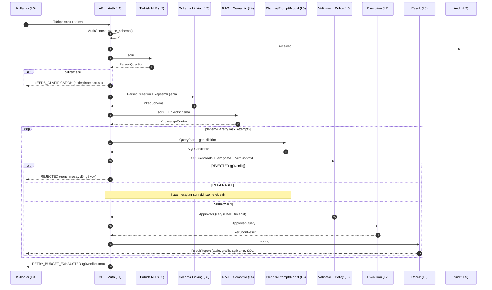

# İstek Yaşam Döngüsü

Bir Türkçe sorunun cevaba dönüşene kadar geçtiği adımlar. Kod karşılığı:
`backend/orchestration/pipeline.py` → `Pipeline.run()`.

## 1. Adımlar

| # | Katman | Modül | Girdi → Çıktı | Audit aşaması |
|---|---|---|---|---|
| 1 | L1 | `api`, `auth` | HTTP isteği → `AuthContext`, `QueryRequest` | `received` |
| 2 | L1 | `auth.scope_schema` | `SchemaSnapshot` + `AuthContext` → **kapsamlı** `SchemaSnapshot` | `scope_schema` |
| 3 | L2 | `turkish_nlp` | soru → `ParsedQuestion` | `parse` |
| 4 | — | `orchestration` | belirsizse → `NEEDS_CLARIFICATION` (model çağrılmaz) | `outcome` |
| 5 | L3 | `schema_linking` | `ParsedQuestion` + kapsamlı şema → `LinkedSchema` | |
| 6 | L4 | `rag`, `semantic_layer` | → `KnowledgeContext` | |
| 7 | L5 | `query_planner` | → `QueryPlan` | `plan` |
| 8 | L5 | `prompt_engine` | → `PromptBundle` (+ önceki denemenin hata geri bildirimi) | |
| 9 | L5 | `sql_generator` → `ModelAdapter` | → `SQLCandidate` | |
| 10 | L6 | `sql_validator` | → `ValidationReport` (verdict) | `validate` |
| 11 | L6 | `policy_engine` | APPROVED rapor → `ApprovedQuery` | |
| 12 | L7 | `execution_engine` → `DatabaseAdapter` | → `ExecutionResult` | `execute` |
| 13 | L8 | `result_engine` | → `ResultReport` | |
| 14 | L9 | `observability` | → `PipelineOutcome` | `outcome` |

## 2. Sıra diyagramı



## 3. Üç hata sınıfı

SQL üretim algoritması üç farklı durumu birbirinden **ayırmak zorundadır**:

| Durum | Örnek | Davranış | Sonuç durumu |
|---|---|---|---|
| **Belirsiz kullanıcı sorusu** | "İyi bayiler hangileri?" | Model çağrılmaz; kullanıcıya netleştirme sorusu sorulur. | `NEEDS_CLARIFICATION` |
| **Düzeltilebilir SQL hatası** | Yanlış sütun adı, sözdizimi hatası, koşulsuz JOIN | Hata mesajı isteme eklenir, yeniden üretilir. Toplam deneme `retry.max_attempts` ile sınırlıdır (varsayılan 3). | Başarılıysa `ANSWERED`, bütçe biterse `RETRY_BUDGET_EXHAUSTED` |
| **Güvenlik ihlali** | `DROP`, yetkisiz tablo, yasaklı sütun, `pg_sleep`, çoklu ifade, sistem kataloğu | **Yeniden üretim döngüsüne gönderilmez, reddedilir.** Modele neden reddedildiği söylenmez. | `REJECTED` |

Ek olarak altyapı hataları (zaman aşımı, bağlantı) `ERROR` döner ve yeniden denenmez.

Gerekçeler: [ADR-0005](../adr/0005-reject-security-violations.md),
[ADR-0006](../adr/0006-bounded-retry-budget.md).

## 4. Algoritma (sözde kod)

```text
auth   ← authenticate(token)                       # L1
schema ← scope_schema(full_schema, auth)           # L1: RBAC şemadan ÖNCE
q      ← parse_turkish(question)                   # L2
if q.ambiguous: return NEEDS_CLARIFICATION(q.ambiguities)
linked ← link(q, schema)                           # L3
know   ← rag(q) ∪ semantic_layer(q, linked)        # L4 (yalnız onaylı kurallar)
plan   ← plan(q, linked, know)                     # L5
feedback ← ∅
for attempt in 1..MAX_ATTEMPTS:                    # ADR-0006
    sql    ← model.generate(prompt(plan, schema, know, feedback))
    report ← validate(sql, full_schema, auth)      # L6
    if report.verdict = REJECTED: return REJECTED  # ADR-0005: asla tekrar deneme
    if report.verdict = REPAIRABLE:
        feedback ← report.failures.messages        # yalnız REPAIRABLE mesajları
        continue
    approved ← policy.approve(report, auth)        # LIMIT, timeout
    result   ← execute(approved)                   # L7 (salt okunur)
    return ANSWERED(build_report(result))          # L8 (deterministik sayılar)
return RETRY_BUDGET_EXHAUSTED                      # güvenli durma
```

## 5. Değişmezler (invariants)

Bunlar testlerle korunur ve hiçbir PR tarafından gevşetilemez:

1. Model, kullanıcının yetkisi olmayan tablo/sütun adını **hiçbir istemde görmez**
   (`test_happy_path`).
2. Güvenlik ihlalinden sonra model **bir kez daha çağrılmaz**
   (`test_security_violation_is_not_retried`).
3. Model çağrı sayısı `retry.max_attempts`'ı **aşamaz** (`test_retry_budget_is_bounded`).
4. Belirsiz soruda model **çağrılmaz** (`test_ambiguous_question_asks_back`).
5. Veritabanı yalnızca `ApprovedQuery` ile çağrılır; adaptör DDL/DML'i kendi başına da
   reddeder (`tests/security/test_sqlite_adapter.py`).
6. Audit kayıtlarında kişisel veri maskelenmiş olur (`test_audit_trail_is_masked`).
